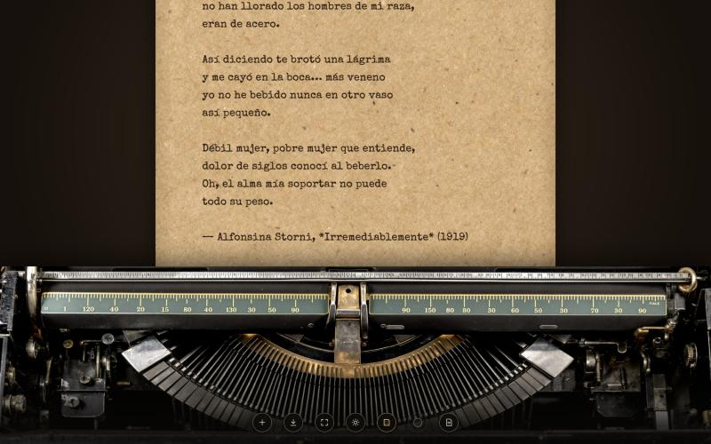
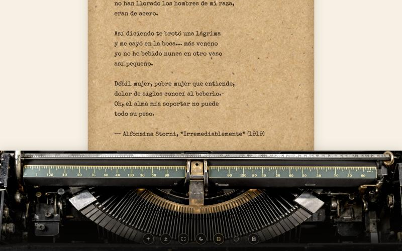
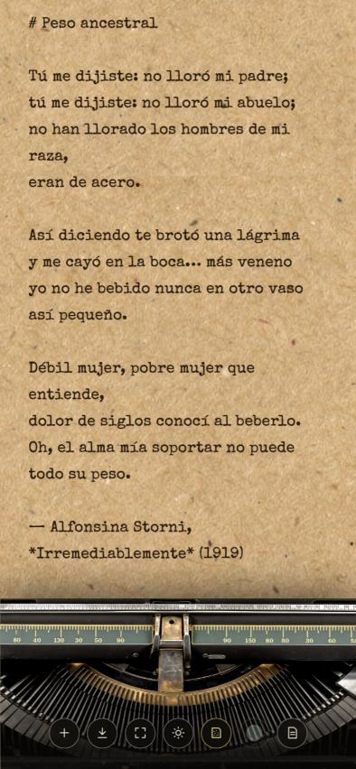
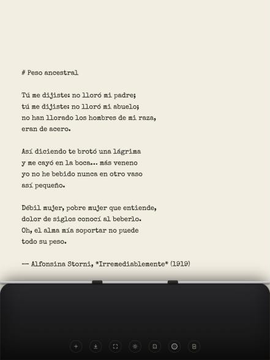

# Typewriter

Un lugar tranquilo para escribir. Una app web minimalista que simula una máquina de escribir: una hoja, una tipografía de máquina y nada más.



## Objetivo

Escribir requiere foco, y la mayoría de los editores están llenos de menús, barras de herramientas, notificaciones y opciones de formato que invitan a hacer cualquier cosa menos escribir.

Typewriter recupera la experiencia de sentarse frente a una máquina de escribir:

- **Una sola cosa en pantalla:** la hoja y el texto.
- **Siempre escribís en el mismo lugar:** la línea actual queda fija justo encima de la barra de la máquina y es el papel el que sube, como en una máquina real.
- **Nada que configurar antes de empezar:** abrís la app y escribís. El texto se guarda solo.
- **Tu texto es tuyo:** se exporta como Markdown (`.md`), un formato abierto que podés abrir en cualquier editor, en Obsidian, Notion, GitHub, etc.
- **Sin cuentas ni servidores:** todo queda en tu navegador.

## Capturas

### Modo retro

Papel madera, tinta marrón como la de una cinta gastada y una máquina antigua de verdad: una foto panorámica del mecanismo de una máquina de los años 30, a todo el ancho de la pantalla, con el carro, las reglas, la guía de tipos y el abanico de varillas a la vista.

| Oscuro | Claro |
| --- | --- |
|  |  |

### Modos claro y oscuro

| Oscuro | Claro |
| --- | --- |
|  |  |

### Estilos de máquina

Cinco colores para la carcasa, combinables con el modo claro u oscuro.

| Negra | Crema | Menta |
| --- | --- | --- |
|  |  |  |

| Roja | Celeste |
| --- | --- |
|  |  |

### Solo la hoja

Para la máxima concentración, la máquina se puede ocultar y queda únicamente la hoja.


### En el celular y la tablet

En pantallas de hasta 1024 px de ancho, toda la pantalla es la hoja: no hay escritorio alrededor, solo papel y la máquina abajo.

<p>
  
  
  
</p>

## Cómo funciona

### Escribir

Abrí la app y empezá a escribir: el cursor ya está en la hoja. A medida que avanzás, el papel sube y la línea que estás escribiendo se queda siempre a la misma altura, justo sobre la barra de la máquina, para que la vista no tenga que perseguir al texto.

Podés volver a leer lo anterior con la rueda del mouse, el trackpad o deslizando el dedo; al seguir escribiendo, la hoja vuelve sola a tu línea. También funciona hacer clic en cualquier parte del texto o moverte con las flechas: la hoja se acomoda para que esa línea quede sobre la barra.

Mientras escribís, los botones se atenúan casi por completo para no distraer, y vuelven a aparecer cuando movés el mouse.

### La primera hoja

La primera vez que abrís la app, la hoja te recibe con *Peso ancestral* de Alfonsina Storni (de *Irremediablemente*, 1919; obra en dominio público), con el cursor listo debajo de la firma. Podés seguir escribiendo ahí o empezar una hoja nueva con **＋**. Desde ese momento, la app guarda y muestra siempre tu propio texto.

### Los botones

Los siete botones están siempre en el mismo lugar —centrados al pie de la pantalla—, en cualquier modo y con cualquier máquina, para que la mano los encuentre sin buscar. Pasando el mouse por encima aparece qué hace cada uno.

| Ícono | Acción |
| --- | --- |
| **＋** | **Hoja nueva.** Borra el texto actual para empezar de cero. Si hay texto, pide confirmación antes. |
| **⤓** | **Descargar.** Descarga el texto como archivo `.md`. |
| **⛶** | **Pantalla completa.** Entra y sale de pantalla completa para escribir sin nada alrededor. |
| **☀ / ☾** | **Modo claro / oscuro.** Cambia el escritorio entre oscuro y blanco. |
| **▤** | **Modo retro.** Papel madera y máquina antigua. Queda resaltado en dorado mientras está activo. |
| **●** | **Estilo de máquina.** Cada clic pasa al siguiente color: negra, crema, menta, roja y celeste. El circulito muestra el color actual. Queda atenuado en modo retro y con la máquina oculta, donde no aplica. |
| **🗎 / ⌨** | **Ocultar / mostrar la máquina.** Deja solo la hoja, o vuelve a mostrar la máquina. |

Todo se combina: modo claro u oscuro, retro o no, cualquier estilo de máquina, y con o sin máquina.

### Atajos de teclado

| Atajo | Acción |
| --- | --- |
| `Ctrl` + `S` (`⌘` + `S` en Mac) | Descargar el texto como `.md` |
| `Ctrl` + `Shift` + `F` (`⌘` + `Shift` + `F` en Mac) | Pantalla completa |
| `Esc` | Salir de pantalla completa |

### Exportar a Markdown

Lo que escribís se descarga tal cual como un archivo `.md`, así que podés usar sintaxis Markdown mientras escribís (`# Título`, `**negrita**`, `- listas`, etc.).

El nombre del archivo se arma con la primera línea del texto: si empezás con `# Carta a mi yo del futuro`, el archivo se llama `carta-a-mi-yo-del-futuro.md`. Si no hay texto, se usa la fecha, por ejemplo `texto-2026-10-14.md`.

### Guardado automático

El texto se guarda automáticamente en tu navegador mientras escribís. Si cerrás la pestaña o recargás la página, todo sigue ahí y la app se abre directamente en tu última línea, con el cursor al final para que sigas donde quedaste.

También se recuerdan tus preferencias: modo claro u oscuro, modo retro, estilo de máquina y si la máquina está oculta.

> **Importante:** el guardado es local, en ese navegador y en ese dispositivo. No hay cuentas ni servidor: nada de lo que escribís sale de tu dispositivo. Si borrás los datos del navegador, usás una ventana de incógnito o cambiás de equipo, el texto no va a estar. Descargá el `.md` de todo lo que quieras conservar.

## Tecnología

- [Next.js](https://nextjs.org/) 16 (App Router) y React 19
- TypeScript
- CSS puro, sin librerías de UI. La máquina de los modos normales está dibujada íntegramente con CSS (gradientes y sombras); los íconos son SVG en línea
- Tipografía [Special Elite](https://fonts.google.com/specimen/Special+Elite), cargada con `next/font`
- `localStorage` para el guardado automático y las preferencias
- [Fullscreen API](https://developer.mozilla.org/docs/Web/API/Fullscreen_API) para la pantalla completa

### Imágenes del modo retro

Las dos imágenes del modo retro fueron generadas con IA a través de [Comfy Cloud](https://www.comfy.org/):

| Archivo | Qué es | Modelo |
| --- | --- | --- |
| `public/papel-madera.jpg` | Textura de papel madera (se repite como mosaico) | Flux 2 Pro |
| `public/maquina-retro.jpg` | Foto panorámica 4:1 del mecanismo de una máquina antigua | Flux Pro 1.1 Ultra |

La foto de la máquina se generó en formato 4:1 para que cubra todo el ancho de la pantalla sin bordes difuminados; en pantallas angostas se recorta alrededor del centro. Como toda imagen generada, tiene algún detalle inventado: los números de las reglas no siguen un orden lógico.

### Cómo se mantiene fija la línea de escritura

El área de texto es un `<textarea>` que crece con su contenido dentro de un contenedor con scroll. Para saber en qué altura está el cursor, la app copia el texto hasta la posición del cursor en un elemento "espejo" invisible con exactamente la misma tipografía y ancho, y mide dónde cae un marcador al final. Con esa medida desplaza el contenedor para que la línea del cursor quede justo encima de la barra de la máquina.

Esto se recalcula al escribir, al mover el cursor, al cambiar el tamaño de la ventana y al cambiar de modo (la máquina retro es más alta). Al abrir la app el ajuste es instantáneo; después, cada cambio de línea se anima suavemente, como el carro de una máquina.

## Instalación y uso local

Requisitos: [Node.js](https://nodejs.org/) 20 o superior.

```bash
git clone https://github.com/meryboth/typewriter.git
cd typewriter
npm install
npm run dev
```

Abrí [http://localhost:3000](http://localhost:3000) en el navegador.

### Scripts

| Comando | Descripción |
| --- | --- |
| `npm run dev` | Servidor de desarrollo con recarga en vivo |
| `npm run build` | Compila la app para producción |
| `npm run start` | Sirve la versión compilada (después de `build`) |

### Publicarla

La app es completamente estática, sin backend, así que se puede publicar gratis en [Vercel](https://vercel.com/): importá el repositorio desde Vercel y no hace falta ninguna configuración extra.

## Estructura del proyecto

```
typewriter/
├── app/
│   ├── layout.tsx         # Layout raíz, tipografía y metadatos
│   ├── page.tsx           # Página principal
│   └── globals.css        # Estilos: escritorio, hoja, máquina, modos, retro y responsive
├── components/
│   └── Typewriter.tsx     # Editor, máquina, botones, atajos, preferencias y guardado
├── docs/
│   └── screenshots/       # Capturas usadas en este README
├── public/
│   ├── papel-madera.jpg   # Textura del papel del modo retro
│   └── maquina-retro.jpg  # Mecanismo de la máquina del modo retro
├── next.config.ts
├── package.json
└── tsconfig.json
```

## Próximas ideas

- Sonido de teclas y campanita al final de la línea (opcional)
- Modo "sin borrar", como en una máquina de verdad
- Más tipografías de máquina para elegir
- Varias hojas o documentos guardados
- Objetivo de palabras diario
